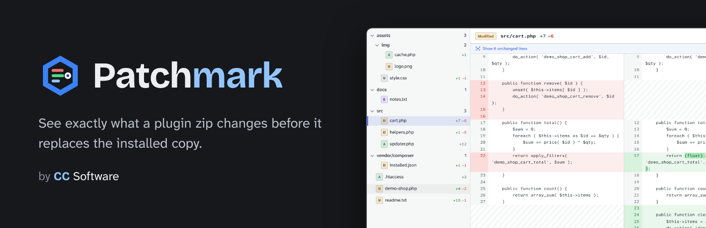
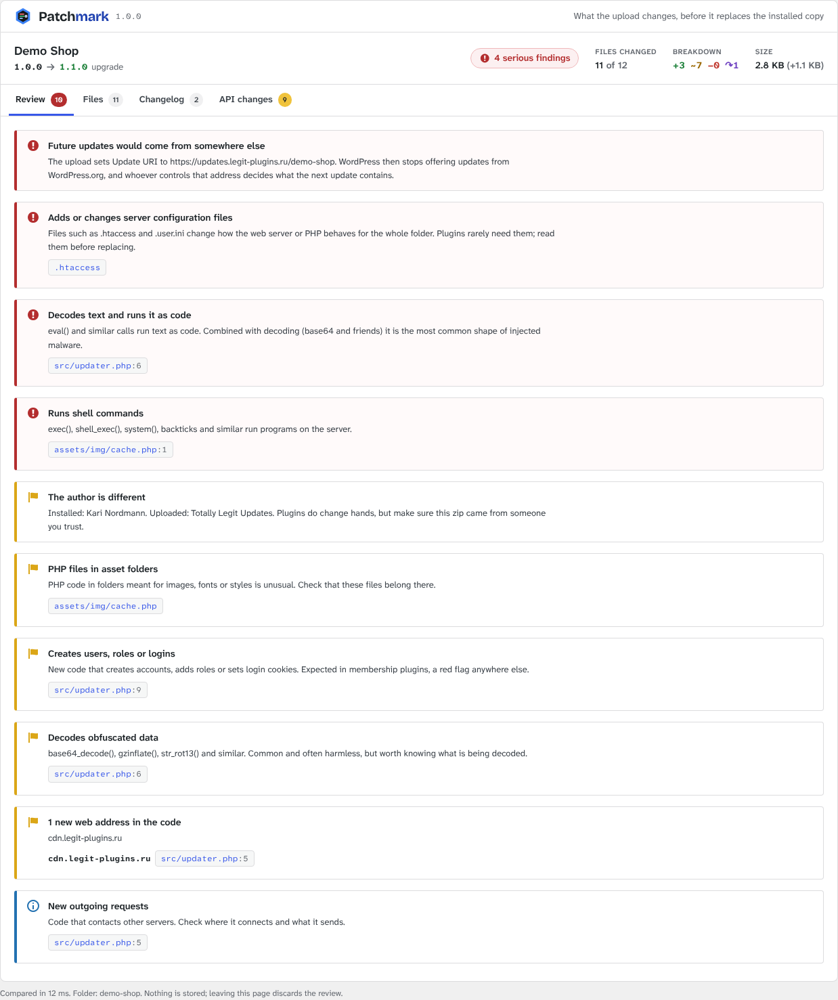
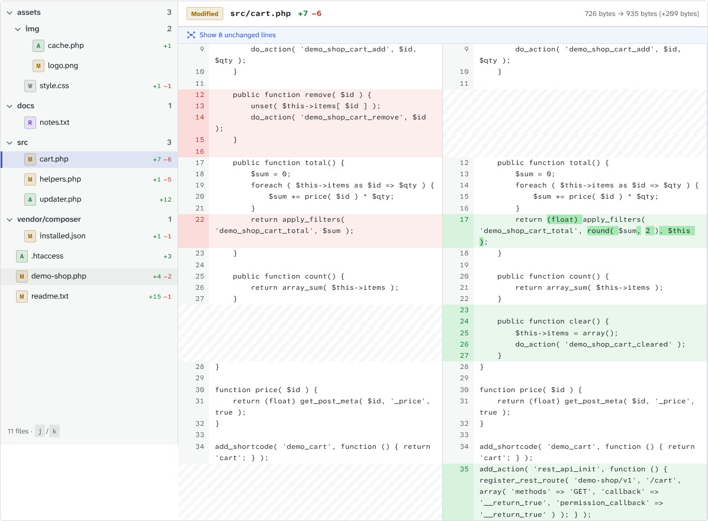
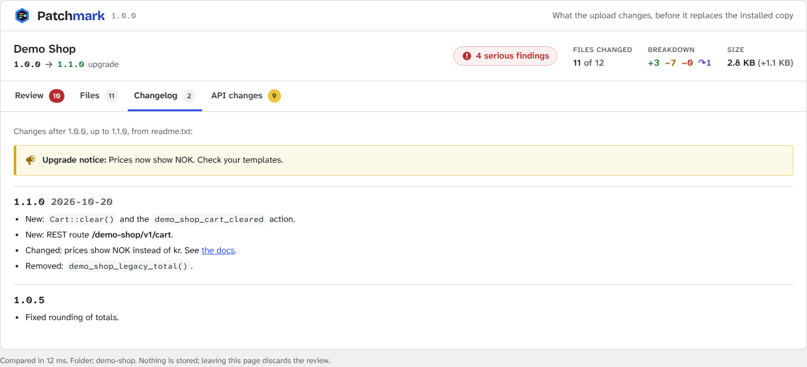
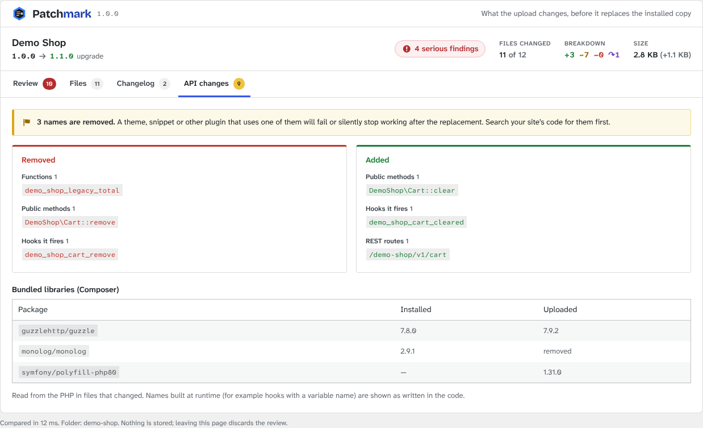

<p align="center">
  
</p>

<p align="center">
  <a href="https://github.com/ClearanceClarence-Software/Patchmark/actions/workflows/ci.yml"></a>
</p>

Patchmark is a WordPress plugin for the moment just before you replace a plugin with a zip. When you upload a plugin that is already installed, WordPress shows a five-row table and a **Replace current with uploaded** button. Patchmark adds what that table leaves out: every file that changed, line by line; anything in the new code that deserves a second look; the changelog between the two versions; and the functions, hooks and routes the upload adds or removes.

It is built for anyone who updates plugins by hand: premium plugins delivered as zips, client sites where a vendor emails "the fixed version", your own plugins between releases, or a zip from a forum that you would rather read before you run.

Requires WordPress 6.6+ and PHP 7.4+. Free and GPL. No settings, nothing stored, nothing sent anywhere.

<p align="center">
  
</p>

## Contents

- [What it shows](#what-it-shows)
- [How it works](#how-it-works)
- [Limits](#limits)
- [Install](#install)
- [For developers](#for-developers)
- [Development](#development)
- [Brand](#brand)
- [Credits](#credits)
- [License](#license)

## What it shows

The review sits below WordPress's own comparison table. A header gives the version change (upgrade, downgrade or same version), a verdict, and how many files changed. Four tabs hold the rest.

### Review

Findings, most serious first. Each one says what was found, why it matters, and links to the file and line, which opens in the file browser with the line highlighted.

**Header and environment**

| Finding | Level |
| --- | --- |
| The upload sets a new **Update URI**: future updates would come from that address instead of WordPress.org | Serious |
| The plugin **name** is different (possibly a different plugin using the same folder) | Serious |
| The **main file** is renamed while the plugin is active (WordPress would deactivate it) | Serious |
| Needs a PHP or WordPress version this site doesn't have | Serious |
| **Older version** than the one installed | Check |
| **Same version number**, different files | Check |
| Different **author** | Check |
| **Requires Plugins** lists plugins that aren't active | Check |
| Becomes network-only | Check |
| Minimum PHP raised, text domain changed, Plugin or Author URI moved to another host, readme Stable tag doesn't match Version | Note |

**Files**

| Finding | Level |
| --- | --- |
| Adds or changes `.htaccess`, `.user.ini`, `php.ini` or `web.config` | Serious |
| PHP with unusual extensions (`.phtml`, `.phar`, `.php7`) or double extensions (`logo.jpg.php`) | Serious |
| PHP in folders meant for images, fonts, styles, uploads or languages | Check |
| Executables and scripts (`.exe`, `.so`, `.sh`, `.bat`, `.ps1`, `.jar`) | Check |
| Almost nothing shared with the installed copy (a rewrite, or a different plugin) | Check |
| Bundled archives, new hidden files | Note |

**Code that is new in the upload**

| Finding | Level |
| --- | --- |
| `eval()`, and the decode-and-run combination with `base64_decode()` and friends | Serious |
| Shell commands: `exec()`, `shell_exec()`, `system()`, `passthru()`, `proc_open()`, `popen()`, backticks | Serious |
| `include` / `require` of a path taken from `$_GET`, `$_POST`, `$_REQUEST` or `$_COOKIE` | Serious |
| `unserialize()` of request data | Serious |
| Long base64 strings | Serious |
| `create_function()`, `assert()` | Check |
| Creating users, adding roles, setting login cookies | Check |
| Decoding: `base64_decode()`, `gzinflate()`, `str_rot13()`, `hex2bin()` | Check |
| New web addresses in the code | Check or note |
| New outgoing requests, new file writes | Note |

### Files

<p align="center">
  
</p>

- **Folder tree** of every added, removed, modified, moved and whitespace-only file, with line counts. Single-child folders are compacted (`vendor/composer`).
- **Split or unified diffs** with word-level highlights, unchanged runs folded behind "Show 12 unchanged lines", and an **Ignore whitespace** switch. Your layout choice is remembered.
- **Moves** are detected: a removed file whose exact contents appear under a new name is shown once, as moved.
- **Whitespace-only** changes (line endings, trailing spaces) are told apart from real ones.
- **Images** are shown side by side, installed and uploaded, on a checkerboard.
- **Filter** by file name or status, or **search inside** the changed files. `j` and `k` step through files.
- **Download .patch**: a git-style patch of the text changes. `git apply` turns the installed copy into the upload, line endings and missing final newlines included. Binary files are listed at the top of the patch.

### Changelog

<p align="center">
  
</p>

The entries between the installed and the uploaded version, read from the upload's `readme.txt` (`= 1.2.0 =` headings) or `CHANGELOG.md` (`## [1.2.0] - 2026-10-20`, with `### Added` groups). The **Upgrade Notice** for the new version is shown on top. For a downgrade, the entries come from the installed copy: the changes you would give up. `code`, **bold** and links are rendered; nothing else from the readme is.

### API changes

<p align="center">
  
</p>

What the upload adds and removes, read from the PHP with the tokenizer:

- functions, classes, interfaces, traits and enums (with namespaces)
- public methods (private and protected ones are left out; methods of a removed class are covered by the class)
- hooks the plugin fires (`do_action`, `apply_filters` and their variants; dynamic names are shown as written, `save_{$post_type}`)
- REST routes, shortcodes, post types and blocks
- Composer packages in `vendor/composer/installed.json` or `composer.lock`: added, removed and updated, with versions

Removed names are the ones that break a theme, a snippet or another plugin that relies on them.

## How it works

WordPress unpacks an uploaded zip into `wp-content/upgrade/`, runs `upgrader_source_selection`, notices that the plugin folder already exists, **deletes the unpacked files**, and then shows the comparison screen. So there is one short window where both copies are on disk.

Patchmark hooks `upgrader_source_selection` at priority 999 (after core's own package check and after plugins that rename GitHub-style folders) and does all its work there:

1. **List** both folders and hash every file with `md5_file()`, without loading it. Version-control and editor clutter (`.git`, `node_modules`, `.DS_Store`, `__MACOSX`) is skipped.
2. **Compare** by hash. Only files whose hash differs are read: to tell whitespace-only changes from real ones, to scan the code, and to send the contents to the viewer.
3. **Scan** both versions of each changed file. Findings are reported only when a signal appears more often in the upload than in the installed copy of the same file, so a plugin that has always used `base64_decode()` isn't flagged for it.
4. **Hand over** the review through `install_plugin_overwrite_comparison`. The data travels as JSON with the script, which prints in the footer; nothing is written to the database.

The viewer is a small React app (`@wordpress/element`, already loaded in wp-admin). Diffs are computed in the browser with Myers' algorithm on lines, then on words for paired lines, so the page carries the two texts once instead of pre-rendered HTML for every file.

If anything in the review throws, the upload screen shows a one-line notice and WordPress carries on as usual. The review never stands between you and the upload.

Nothing runs on any other screen. The stylesheet loads only on `update.php?action=upload-plugin`, and the script only when there is a review to show.

## Limits

| | |
| --- | --- |
| Files per package | 20,000 (the rest are not compared, and the review says so) |
| File contents shown in the viewer | up to 512 KB per file, 8 MB of text in total, modified files first |
| Image previews | up to 256 KB per image |
| Code scanned | up to 2 MB per file, 40 MB in total per side |
| Changelog entries shown | 25 |

Files over a limit are still compared by hash and listed. Formidable Forms (1,841 files, 29 MB) with 46 changed files is compared and scanned in about 0.4 seconds.

Single-file plugins (a lone `.php` in `wp-content/plugins`) and themes aren't covered yet.

The code checks point at changes worth reading. They are not a malware scanner, they can't prove a plugin is safe, and some findings are normal for some plugins (a membership plugin creates users). Only install code from sources you trust.

## Install

From a release zip: **Plugins › Add New › Upload Plugin**, choose `patchmark-<version>.zip`, activate.

From source: see [Development](#development).

Then upload any plugin you already have installed. The review appears under WordPress's table.

## For developers

**Filters**

`patchmark_ignore` changes which file and folder names are left out of the comparison.

```php
add_filter( 'patchmark_ignore', function ( $names ) {
	$names[] = 'tests';
	return $names;
} );
```

**Engine checks**

`tests/check.php` builds an installed and an uploaded copy of a small plugin in a temporary folder (the upload with planted problems), runs the review and checks 23 results: counts, moves, whitespace, every finding type, API changes, changelog ranges, downgrades and identical copies. The suspicious code is written at test time, so it never sits in the repository as PHP.

```bash
wp eval-file tests/check.php
```

## Development

The admin app is TypeScript and SCSS, built with `@wordpress/scripts`, the same setup as [Routemark](https://github.com/ClearanceClarence-Software/Routemark) and [Unified Blocklist](https://github.com/ClearanceClarence-Software/Unified-Blocklist). The build is not minified, so `build/` is readable as it ships.

```bash
npm install
npm start          # watch build while developing
npm run typecheck
npm run lint:js
npm run zip        # build + dist/patchmark-<version>.zip
```

PHP follows the WordPress Coding Standards; `phpcs.xml.dist` is included.

| Folder | What's in it |
| --- | --- |
| `src/` | PHP: capture and screen (`Plugin`), file listing (`Package`), comparison (`Comparison`), findings and API changes (`Review`), tokenizer scan (`CodeScan`), changelog (`Changelog`) |
| `app/` | The viewer: React + TypeScript, with the diff and patch code in `app/lib` |
| `build/` | Compiled viewer (generated, not committed) |
| `tests/` | Engine checks |
| `licenses/` | Font licenses (Bricolage Grotesque, Atkinson Hyperlegible Next and Mono, OFL) |
| `.wordpress-org/` | Icon, banners and screenshots for the plugin directory |

The GitHub workflow typechecks, lints, runs PHPCS, builds, and attaches the plugin zip to every push.

## Brand


Patchmark is a CC Software plugin, a sibling of [Routemark](https://github.com/ClearanceClarence-Software/Routemark) and [Unified Blocklist](https://github.com/ClearanceClarence-Software/Unified-Blocklist), and uses the same look. The name is one word with a capital P. In the wordmark, "Patch" is in the text color and "mark" is in blue, as in Routemark.

The mark is the CC Software hex well with a diff inside it: a removed line in red, an added line in green that ends in Routemark's marker, and an unchanged line in light blue. The well is always graphite, so the same mark works on light and dark backgrounds.

| | |
| --- | --- |
| Blue `#3B82F6` | Outer hex |
| Graphite `#16181B` | Hex well, banner background |
| Dark blue `#1E40AF` | "mark" on light backgrounds, marker center |
| Light blue `#93C5FD` | Unchanged line, "mark" on dark backgrounds |
| Red `#F87171` | Removed line |
| Green `#4ADE80` | Added line |

The review sits inside a core WordPress screen, so, like Routemark's light theme, it has no palette of its own: wp-admin's grays and the user's admin color scheme (`--wp-admin-theme-color`), with the usual green and red for additions and removals. A brand bar with the mark, wordmark and version tops the review, as Routemark's top bar does.

The wordmark is set in Bricolage Grotesque. Everything else uses Atkinson Hyperlegible Next, and code uses Atkinson Hyperlegible Mono, which keeps `l`, `I`, `1`, `O` and `0` apart; that matters when a change is one character. All three are bundled under the OFL.

Patchmark was called Upload Diff during development. Same plugin, new name.

## Credits

Bricolage Grotesque (Copyright 2022 The Bricolage Grotesque Project Authors) and Atkinson Hyperlegible Next and Mono (Copyright 2020-2024 The Atkinson Hyperlegible Next / Mono Project Authors), all under the SIL Open Font License 1.1. Bundled in `build/fonts`, licenses in `licenses/`. Served from the plugin folder, never from Google.

The line diff is Eugene W. Myers' O(ND) algorithm ("An O(ND) Difference Algorithm and Its Variations", 1986).

## License

GPL-2.0-or-later. See [LICENSE](LICENSE).

Made by [CC Software](https://github.com/ClearanceClarence-Software).
